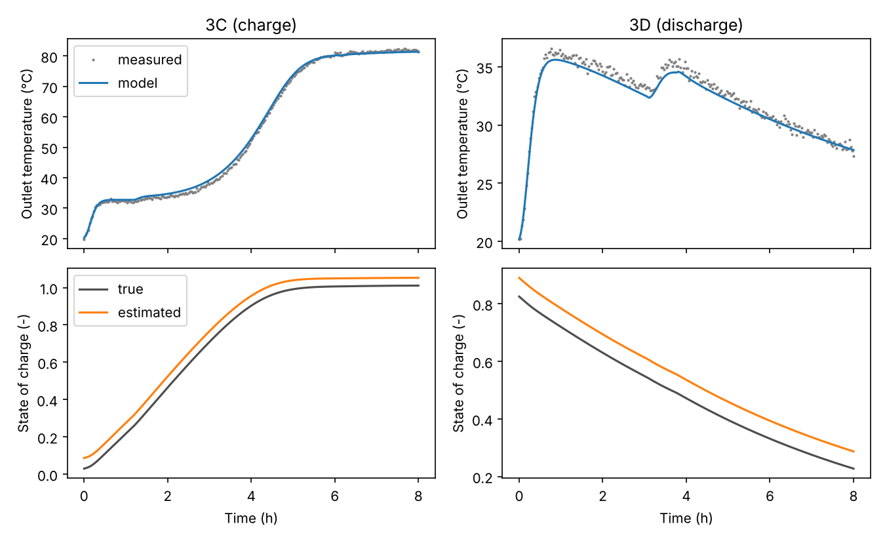

# psrnn: physics-structured recurrent networks for open sorption heat stores

[](https://github.com/fkuznik/psrnn-sorption/actions/workflows/tests.yml)
[](LICENSE)

`psrnn` estimates the state of charge (SoC) and the heat power of an open packed-bed sorption heat store
from the sensors an installation already has: air flow rate, inlet and outlet temperature, inlet and
outlet humidity. No sensor gives the water content of an adsorbent bed during operation, so the SoC has
to be inferred from the outlet signals by a model. `psrnn` provides that model as a recurrent network
whose structure carries the physics.

The bed is split into K slices along the air path. The state of each slice is its water content and
its solid temperature; each time step applies exact water and energy balances, slice after slice. Only
the closures are learnt:

* the isotherm (Toth, Langmuir or Dubinin-Astakhov), kept near its reference values by a prior;
* the numbers of transfer units for water and heat, modulated by a small network shared by the slices;
* the heat losses of the bed and of the outlet duct, the wall capacity and the heat of adsorption.

Because the water balance is built in, the SoC is bounded and conserved by construction, and the model
can be trained **without SoC labels**, from outlet measurements only: the initial water content of each
training phase is learnt with the model, and an observer estimates it for a new phase from its first
hours of measurements.

## Installation

```bash
pip install git+https://github.com/fkuznik/psrnn-sorption
# or, from a clone, with the test and plotting extras
pip install -e ".[test,plot]"
```

Python 3.10 or later, PyTorch 2, NumPy and pandas. A CPU is enough: a 6-slice model of an 8 h phase at
a 5 min step runs in a fraction of a second.

## Quick start

```python
import pandas as pd
import psrnn

# 1. describe the bed
bed = psrnn.BedConfig(adsorbent_mass=10.0,      # kg of dry adsorbent
                      water_min=0.29,           # kg of water at the charged state (SoC = 1)
                      water_max=2.79,           # kg of water at the discharged state (SoC = 0)
                      cross_section=0.05,       # m2
                      n_slices=4)
isotherm = psrnn.DubininAstakhov(q0=0.36, E=3400.0, n=0.9)

# 2. load measured phases (one row per time step, one column naming the phase)
df = pd.read_csv('my_store.csv')
phases = psrnn.phases_from_dataframe(
    df, phase_col='phase',
    columns=dict(time='t_s', flow='Q_m3h', T_in='T_in_C', pv_in='pv_in_Pa',
                 T_out='T_out_C', pv_out='pv_out_Pa'),
    group_col='test', kind_col='kind')

# 3. train without SoC labels, the initial state of each phase being unknown
result = psrnn.train(lambda: psrnn.SorptionBedRNN(bed, isotherm), phases, epochs=100,
                     latent_init=True, weights=psrnn.LossWeights(w_soc=0.0))

# 4. estimate the SoC of a new phase from its first 2 h of measurements
pred = psrnn.predict(result.model, new_phase, window_h=2.0)
print(pred[['time_s', 'T_out_pred_C', 'soc_pred']])
```

## Examples

| Folder | Store | What it shows |
|---|---|---|
| [`examples/silica_gel_bed`](examples/silica_gel_bed) | laboratory bed, 10 kg of silica gel, Dubinin-Astakhov isotherm | training without SoC labels on simulated measurements whose truth is known; the SoC of two unseen phases is recovered within 0.05 to 0.06 |
| [`examples/staid`](examples/staid) | one module of the full-scale STAID store, 40 kg of zeolite 13X, Toth isotherm | the workflow on two measured phases of the prototype |



## What the package contains

| Module | Content |
|---|---|
| `psrnn.config` | `BedConfig`: geometry, SoC reference states, initial values of the physical parameters |
| `psrnn.isotherms` | `Toth`, `Langmuir`, `DubininAstakhov`, and the `Isotherm` base class for new ones |
| `psrnn.model` | `SorptionBedRNN`, the recurrent bed model |
| `psrnn.data` | `Phase`, `phases_from_dataframe`, `make_batch` |
| `psrnn.training` | `train` (with or without SoC labels, latent initial state), `leave_one_group_out` |
| `psrnn.observer` | `observe_soc`: initial state of a phase from its outlet measurements |
| `psrnn.metrics` | `predict`, `evaluate`, exchanged energy, heat power, conformal prediction intervals |
| `psrnn.synthetic` | phases with piecewise-constant inlet conditions, simulated outlets |
| `psrnn.presets` | the STAID configuration |

The documentation is in [`docs/`](docs): [model](docs/model.md), [tutorial](docs/tutorial.md),
[API](docs/api.md).

## Tests

```bash
pytest -q
```

The tests check that the pressure of each isotherm inverts its loading, that the water balance of the
model closes to machine precision, that the observer recovers a known initial state, and that the
package reproduces, on the STAID demonstration data, the outputs and training losses of the companion
code archived at [10.5281/zenodo.23477614](https://doi.org/10.5281/zenodo.23477614).

## Citation

See [`CITATION.cff`](CITATION.cff). The STAID application is described in a manuscript under review;
the reference will be added here on publication.

## Authors and license

Frédéric Kuznik (INSA Lyon, CNRS, CETHIL UMR5008), Bilal Lamrani (Mohammed V University in Rabat),
Kévyn Johannes (INSA Lyon, CNRS, CETHIL UMR5008). MIT License, see [`LICENSE`](LICENSE).
Questions and bug reports: [issues](https://github.com/fkuznik/psrnn-sorption/issues).
